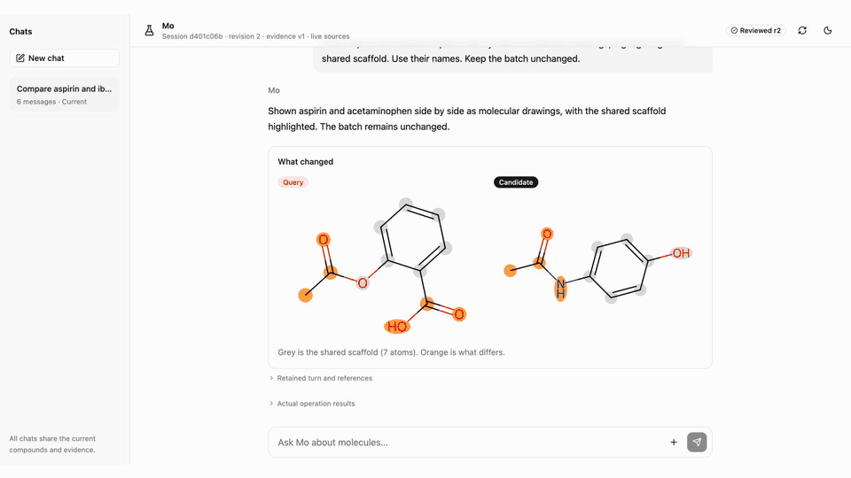

# Mo

A molecular screening and evidence workbench, starting with CYP inhibition.

[Watch the 2:30 demo on YouTube](https://youtu.be/WdQMBiXYQ-8)

## Inside the workbench

Compare molecular drawings, explore live ChEMBL analogues, and follow the research
sources behind the assay records. Build a shortlist by setting its size and
similarity limit, then requiring or excluding individual compounds.

[](https://youtu.be/WdQMBiXYQ-8)

## Run the demo

The repository includes the frozen model bundles, original CYP input tables,
recorded evidence, sample compounds, and built interface. No retraining or frontend
build is required to open the workbench.

```sh
uv sync --locked
.venv/bin/python scripts/verify_release.py
.venv/bin/python -m src.workbench --source-mode recorded
```

Open **http://127.0.0.1:8765**. Use **+ → Load 20-compound sample**, inspect the
candidates, compare structures, and retrieve the bundled recorded evidence. These
controls work without credentials. To use the conversational assistant and live
sources, set `OPENROUTER_API_KEY` in the launching shell, then start with
`--source-mode live`. Calls use your provider account; keys and paid-call logs are
not included in the repository.

The [retained demo session](examples/named-drugs-demo-session.json) contains the
recorded chat and tool results. macOS requires
the OpenMP runtime for the supplied LightGBM/XGBoost models (`brew install libomp`).

An exploratory study of five CYP assay-label predictors, as deterministic
scientific computing. Structure in, five uncalibrated inhibition scores out, with
an exact-structure experimental-evidence lookup and a constrained screening
shortlist on top. Offline scoring and selection are deterministic for the same
inputs and frozen artifacts. Evidence lookup queries live ChEMBL and records the
retrieval time; observations can change between runs. There is no LLM, agent, or
network inference in the **prediction** path: the classifiers are deterministic.

A language model appears in two places beside that path. It is the *subject* of the
benchmark's input-only arms, which score the same frozen cohort from a SMILES string
or a name alone, and it drives Mo, the workbench assistant that calls the deterministic
tools. The assistant reports tool-produced classifier scores; its prose does not
replace them.

## Repository map

| Location | Purpose |
| --- | --- |
| `src/chemistry/` | Molecular identity, features and structure drawings |
| `src/prediction/` | Frozen classifiers, training and CYP analysis |
| `src/sources/` | ChEMBL assay retrieval and PubChem name lookup |
| `src/screening/` | Candidate validation, constrained selection and batch reports |
| `src/benchmark/` | Frozen benchmark runs, evaluation and similarity-stratified metrics |
| `src/workbench/` | Local API, session state, scientific operations, assistant and paid ledger |
| `src/research/` | Cross-dataset similarity study and scientific figures |
| `ui/src/` | Authored React interface; build output stays in `src/workbench_web/` |
| `experiments/` | Archived CYP/ORD probes, the incomplete KIBA notebook and the Jev routing experiment |

`data/` and `artifacts/` contain the frozen CYP inputs and models used for this
release. `runs/` holds local executions and is not tracked. `results/` and `audit/`
contain retained scientific outputs. Optional cached datasets for the archived
experiments are not part of the supported demo.

Run command modules with `python -m` from the repository root. The main entry
points are `src.workbench`, `src.screening` and `src.benchmark`; training,
evaluation and source lookup commands live in their respective packages below.

## Local workbench

```sh
.venv/bin/python -m src.workbench --source-mode recorded
```

Open `http://127.0.0.1:8765`. Recorded mode uses the bundled evidence fixture;
`--source-mode live` explicitly selects live ChEMBL lookups. The direct controls
work without an LLM credential. Set `OPENROUTER_API_KEY` in the environment to
enable the assistant. Both batch and chemistry questions use the same admitted
operation, deadline, evidence snapshots and durable paid-call ledger.

The standalone chat command uses the same assistant and requires an explicit
candidate dataset:

```sh
.venv/bin/python -m src.workbench.chat 'Compare candidate-01 and candidate-02' \
  --candidates examples/cyp3a4-candidates.csv --source-mode recorded
```

`runs/workbench/paid-calls.jsonl` retains paid accounting across restarts. Do not
delete or reset it to retry a failed request. See [the UI guide](ui/README.md) for
build and development commands.

## CYP3A4 core workflow

Use the locked Python environment from this project's root. The supplied candidate
CSV contains the first 20 frozen test structures with opaque IDs; labels were
removed and neither scores nor outcomes were used to choose these rows.

Create a reviewable experimental batch with predictions, selection reasons, and
exact-structure ChEMBL measurements in separate sections:

```sh
.venv/bin/python -m src.screening plan \
  --candidates examples/cyp3a4-candidates.csv --budget 4 \
  --include candidate-20 --exclude candidate-15 --evidence-limit 3 \
  --output runs/batch.json --report runs/batch.md
```

The objective is to find likely **CYP3A4 inhibition assay hits**. Budget counts
compounds, including required inclusions; it is not a monetary budget. The planner
selects once using the rules below, then queries only selected compounds with one
shared evidence client (at most three requests per compound). The default evidence
limit is 10 observations per compound, adjustable from 1 to 50. Each request uses
the existing 10-second timeout; a large batch can take time.

Measurements accompany the proposal for review; they do not change model scores
or automatically exclude compounds. A published assay may differ from the intended
experiment. Review the observations and rerun with revised `--include`/`--exclude`
IDs when appropriate. This workflow has not demonstrated reduced redundant testing
or improved experimental yield. It does not optimize for avoiding inhibition.

JSON retains the full selection and returned observations; `--report` adds a
readable Markdown view. Required inclusions are identified separately from ranked
picks. Missing evidence never means inactive or never tested. Lookup failures and
truncated results remain visible, and partial measurements survive errors. Exit
codes are 0 for a completed report, 1 for an input/runtime error, and 2 for a
partial report (an incomplete batch, lookup error, or truncated evidence). Check
`complete` for batch completion and each evidence entry for retrieval status.
The planner rejects report paths that alias the candidate CSV, loaded model, or
each other, including symlinks and hardlinks. Existing report files at other paths
are overwritten when rerunning the command. Argument-usage errors also exit 2,
without a report. If writing a file fails, the command exits 1 with a stderr message;
the computed JSON remains on stdout, with its original computation status.

For selection without network calls, or a separate evidence lookup:

```sh
.venv/bin/python -m src.screening shortlist \
  --candidates examples/cyp3a4-candidates.csv --budget 4 \
  --output runs/shortlist.json

.venv/bin/python -m src.screening shortlist \
  --candidates examples/cyp3a4-candidates.csv --budget 4 \
  --exclude candidate-15 --include candidate-20 \
  --output runs/shortlist-revised.json

.venv/bin/python -m src.screening evidence \
  --smiles 'Cn1c(=O)c2c(ncn2C)n(C)c1=O' --limit 3 \
  --output runs/caffeine-evidence.json
```

Your input CSV needs `id,smiles`. Extra columns, including labels, are discarded.
Duplicate IDs, duplicate canonical structures, and invalid structures are rejected.
Selection reserves mandatory IDs, then fills in descending model-score order
(stable ID tie break). `--max-similarity` defaults to 0.8: every selected pair must
have Morgan Tanimoto similarity at most that value. It is a diversity setting,
not a calibrated reliability threshold. Excluded IDs cannot be selected. Conflicting
mandatory constraints fail explicitly. A valid but incomplete greedy batch has
`complete=false` and an explanation; this does not prove no feasible batch exists.
No constraint is silently relaxed. Scores and validation percentiles are uncalibrated.

Evidence lookup searches ChEMBL human CYP3A4 (`CHEMBL340`) and verifies canonical
isomeric identity before attaching assay measurements. Salts, charge, isotopes,
and stereochemistry are preserved. Results include original and standardized
measurement fields, source links, assay descriptions, truncation, and known
Veith-source overlap. Different measurements are never averaged. `not_found` and
`identity_mismatch` do not mean inactive. Partial remote failures return `error`
while retaining already retrieved measurements. The default request timeout is
10 seconds, with at most three sequential requests and no hidden retries.
`veith_overlap=false` only excludes the recognized PubChem1851_3 mirror; it does
not prove independent evidence. No compound-name resolution or disagreement
interpretation is included in these two core functions.

## Setup

Use Python 3.11. The dependency lock includes PyTDC's RDKit 2023.9.6 and the
setuptools version that still provides `pkg_resources`. PyTDC brings a large
transitive dependency set. LightGBM/XGBoost also require their platform's OpenMP
runtime; the tested macOS host already has it.

```sh
cd mo
uv sync --locked
.venv/bin/python -m pytest tests -q
```

`uv.lock` is the default install path. `requirements.lock.txt` retains the original
scientific environment and can also be installed with `uv pip sync`; shared package
versions match.

## Train and freeze a run

```sh
.venv/bin/python -m src.prediction.train --data-dir data --output-dir runs/retrained-models --seed 42 --jobs 4
.venv/bin/python -m src.benchmark prepare --artifacts runs/retrained-models --run-dir runs/pilot --limit 120
.venv/bin/python -m src.benchmark classifier --artifacts runs/retrained-models --run-dir runs/pilot
.venv/bin/python -m src.benchmark.evaluate --run-dir runs/pilot --bootstrap 1000 --seed 42
```

## Compare the classifiers against input-only LLM baselines

```sh
.venv/bin/python -m src.benchmark prepare --artifacts artifacts --run-dir runs/pilot-llm --limit 120
.venv/bin/python -m src.benchmark classifier --artifacts artifacts --run-dir runs/pilot-llm
.venv/bin/python -m src.benchmark smiles --run-dir runs/pilot-llm --max-calls 200 --workers 8
.venv/bin/python -m src.benchmark.evaluate --run-dir runs/pilot-llm --arms classifier smiles \
  --bootstrap 2000 --seed 42
.venv/bin/python -m src.benchmark.similarity_bands --run-dir runs/pilot-llm --arms classifier smiles \
  --output audit/novelty_decomposition_llm.csv
```

The `smiles` and `name` arms are paid OpenRouter calls that score the same frozen
cohort from one input channel only, with no tools and no classifier evidence.
They read `OPENROUTER_API_KEY` from the environment or `.env`, cap calls per
invocation, and resume: a molecule already scored for that arm is skipped.
The cap counts requests, with SDK retries disabled. Negative caps and invalid worker
counts are rejected before work starts. The first invocation freezes that arm's
model, prompt, score schema and exact inputs in `llm_<arm>_manifest.json`, including
unresolved names. Populate the name cache before starting the name arm:

```sh
.venv/bin/python -m src.sources.pubchem --cohort runs/pilot-llm/cohort.csv \
  --output runs/pilot-llm/names.jsonl
.venv/bin/python -m src.benchmark name --run-dir runs/pilot-llm --max-calls 200
```

Resume rejects changed conditions before calls or result writes. Existing paid
records without this provenance cannot be resumed or silently migrated; use a new
run directory. They remain available for evaluation. Even an initial zero-call
invocation freezes the arm's conditions.
`src.benchmark.similarity_bands` repeats the paired contrast inside bands of nearest-training
similarity, because a single pooled number averages over molecules that nearly
duplicate the training set and molecules that do not resemble it at all.

The committed `data/` and `artifacts/` preserve the original input and model bytes.
Their hashes are retained in the training and cohort manifests and checked by
`scripts/verify_release.py`. Retraining is a new experiment: its creation timestamp
and potentially serialized model bytes differ, so it must use a new output directory
and a new benchmark run. It is not expected to reproduce historical file hashes.

Set `ENDPOINTS` to a comma-separated subset of the five CYP endpoints to restrict
training and evaluation; the models must be retrained for that subset. Arbitrary
new endpoints also require model-family and dataset mappings in `src/prediction/train.py`.
`--arms` makes evaluation report only arms the run actually contains; metrics use
the population where every requested arm succeeded, so adding an arm shrinks the
paired cohort. The name arm uses `names.jsonl`, whose PubChem titles are mostly
systematic names; it is a notation baseline, not a test of name recall.

Training refuses to overwrite a nonempty output directory. The supplied artifacts
can be reused; do not repeat the training command against those artifacts.
`prepare` likewise requires a new run directory. Omit `--limit` to select the entire
test set for a final run. A pilot is a wiring/feasibility check, not the full study.
`classifier` resumes: a molecule already scored in `predictions.jsonl` is skipped,
and a changed artifact hash refuses the run rather than mixing models.

`src/sources/pubchem.py` supplies the standalone PubChem structure-to-title cache used by
the name baseline. Its titles may be systematic names, not familiar drug names.

## Read the results

- `results/screening-budget/`: reproducible CYP3A4 screening-budget figure, all
  selected compound IDs, observed hit counts and scaffold coverage. Run
  `.venv/bin/python -m src.research.screening_budget` offline from the frozen
  cohort and predictions; no trained models or paid calls are needed.
- `artifacts/train_metrics.csv`: actual classifier validation/test AUC and AP.
- `artifacts/manifest.json`: versions, raw-data and source hashes, split audit,
  cleaning, feature order, model parameters, and limitations.
- `runs/<name>/metrics.csv`: per-endpoint AUC/AP with scaffold-bootstrap intervals.
- `runs/<name>/summary.json`: attempted/failed/missing predictions, observed
  labels, class balance, and evaluated cohort sizes.

Missing labels and failures are never converted to zeros. An endpoint with one
observed class has undefined AUC and AP and says so. Intervals come from
resampling scaffolds, so they capture split variability, not training-seed
variability.

## Scientific limits

The previous feasibility ladder selected models using its test split. This build
preserves those selected families and reports an **exploratory retest**, not a clean
confirmatory evaluation. It uses one scaffold split of the canonical union across
all five datasets so a test molecule cannot be seen by another enzyme's classifier.
The fixed families and original tree parameters are retained; there is no new
test-set search. The changed cohort means its metrics are not directly comparable
to the earlier per-dataset split table.

RDKit canonical isomeric identity does not normalize salts or tautomers. Conflicting
duplicate endpoint labels become missing. Scores are uncalibrated; validation
percentiles are ranks against a recorded reference, not clinical confidence.
The 95th-percentile nearest-other training Tanimoto threshold is a heuristic flag,
not proof of applicability. Flagged molecules remain in the primary metrics.

Bootstrap intervals resample scaffolds and do not capture training-seed variation.
Metrics condition on successful predictions; always show coverage alongside them.
Veith labels describe assay inhibition, not substrate status, metabolic rate, or
clinical effects — so these scores do not predict which enzyme clears a drug.

Implementation references: [TDC scaffold splitting](https://tdc.readthedocs.io/en/main/_modules/tdc/utils/split.html),
[RDKit descriptors](https://www.rdkit.org/docs/source/rdkit.Chem.Descriptors.html),
[PubChem PUG REST](https://pubchem.ncbi.nlm.nih.gov/docs/pug-rest),
[ChEMBL web services](https://chembl.gitbook.io/chembl-interface-documentation/web-services/chembl-data-web-services).
