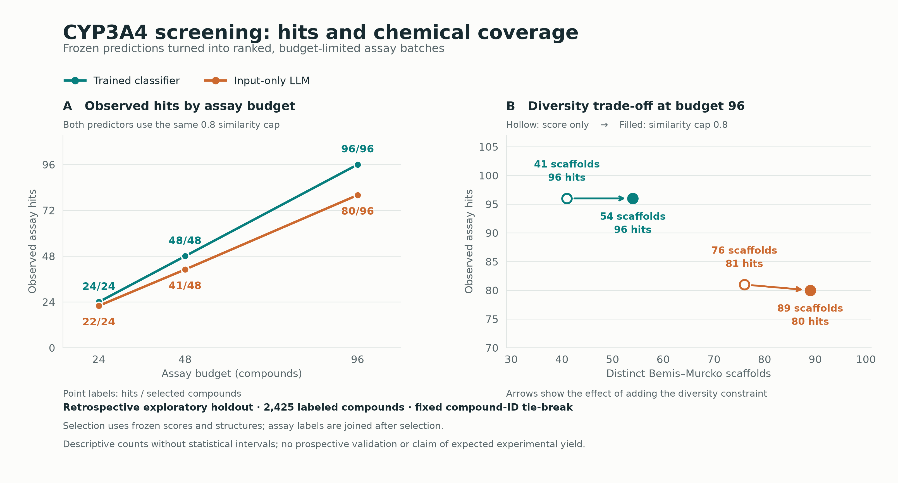

# CYP3A4 screening under a compound budget

This package turns frozen classifier and input-only LLM scores into explicit
experimental-batch proposals, then reveals their existing assay labels. It connects
predictive performance to two concrete screening outcomes: observed hits and chemical
coverage at a fixed number of selected compounds.



**On this fixed retrospective cohort, the classifier's 96-compound batch contains
96 observed inhibition hits versus 80 for the LLM-ranked batch under the same
pairwise similarity cap. The LLM batch covers more scaffolds: 89 versus 54.**
Adding the cap to classifier score-only selection increases represented scaffolds
from 41 to 54 while preserving 96 observed hits in this particular batch.

## Reproduce offline

From the repository root, with the existing locked Python 3.11 environment:

```sh
.venv/bin/python -m src.research.screening_budget
```

No model bundles, retraining, credentials, or network calls are needed. The command
uses the released predictions and the exact frozen cohort now included in
`results/full-llm/cohort.csv`. It verifies the cohort SHA256 against the original
`cohort_manifest.json` before computing anything. See the root README for installing
the locked environment. To retain the packaged outputs and regenerate separately:

```sh
.venv/bin/python -m src.research.screening_budget --output /tmp/cyp-screening-reproduction
```

The script reuses the workbench's `src.shortlist.select_shortlist`; it is not a
separate implementation of selection. Compare `summary.csv` and
`selected-compounds.csv` byte-for-byte between runs. `provenance.json` records source,
input and output hashes plus runtime versions. PNG, vector SVG, and PDF are exported.

## Complete results

Each cell lists the results at budgets **24 / 48 / 96** compounds. All batches filled.

| Ranking and selection | Observed hits | Distinct Murcko scaffolds |
|---|---|---|
| Classifier, score only | 24 / 48 / 96 | 11 / 20 / 41 |
| Classifier, similarity cap 0.8 | 24 / 48 / 96 | 14 / 23 / 54 |
| Input-only LLM, score only | 23 / 43 / 81 | 16 / 36 / 76 |
| Input-only LLM, similarity cap 0.8 | 22 / 41 / 80 | 21 / 43 / 89 |

The frozen partition contains 3,274 unique molecules. There are **2,425 with an
observed CYP3A4 label and successful scores from both arms**, including **1,133
positives (46.72%)**. The remaining 849 lack this endpoint's label; none are treated
as inactive. No labelled molecule is lost to prediction failure in this run.

## What is compared

The classifier arm uses the previously trained CYP3A4 model; the `smiles` arm uses
the saved `anthropic/claude-haiku-5.5` predictions with only a molecular SMILES input.
The fixed budgets are illustrative. They do not represent a validated laboratory
operating budget, and each batch is independently selected from the full eligible
pool, not from the output of the preceding batch.

Both policies rank by descending score and break ties by ascending original
molecule ID. Score-only selection uses maximum similarity 1.0. The constrained
policy uses the existing 0.8 maximum pairwise Morgan Tanimoto similarity, radius 2,
2,048 bits. No required inclusions or exclusions are added. Selection receives
only ID, structure and score; labels and scaffolds are joined afterward.

The cap does **not** optimize scaffold coverage. Distinct nonchiral Bemis–Murcko
scaffold count is a separate descriptive measure; it is not a validated measure of
scientific usefulness. More observed hits and broader coverage are different goals.

Ties matter. At budget 96, the constrained LLM selection takes **52 of 84 molecules
tied at score 0.70**. The fixed ordering makes this reproducible, not insensitive to
ordering. Every row of `summary.csv` includes the cutoff score, tied-pool size and
number selected from the tie. Alternative tie orders and statistical uncertainty
have not been estimated. There are no confidence intervals in this figure.

## Interpretation and limits

This is a **post-hoc retrospective analysis of one exploratory split**, not a
prospective assay result or an independent replication. Earlier classifier-family
selection used test performance. Observing 96 existing positive labels in 96 picks
does not predict 100% yield in a future laboratory screen, establish saved time or
money, or demonstrate an advantage over existing ADMET software. The LLM has broader
scaffold coverage in these batches, so neither method dominates both displayed goals.

Labels describe inhibition in the underlying assay, not substrate status, clinical
risk, or safety. The processed TDC binary-label and exclusion rules remain incompletely
verified. No acyclic compounds occur in this held-out cohort. No comparison establishes
whether the LLM encountered these public compounds during its training.

Data originate from [the Veith et al. CYP profiling study](https://doi.org/10.1038/nbt.1581),
as distributed through [Therapeutics Data Commons](https://tdcommons.ai/single_pred_tasks/adme/).
This package does not assert a new license for those source data. Frozen cohort and
prediction provenance are retained in `../full-llm/`.

## Files

- `screening-budget.png`, `.svg`, `.pdf`: the same figure in presentation/export formats.
- `summary.csv`: all 12 method/policy/budget combinations, including tie diagnostics.
- `selected-compounds.csv`: each selected ID, structure, rank, score, observed label
  and scaffold; a molecule can recur across distinct batches.
- `provenance.json`: input/source/output hashes, versions, coverage and fixed settings.
